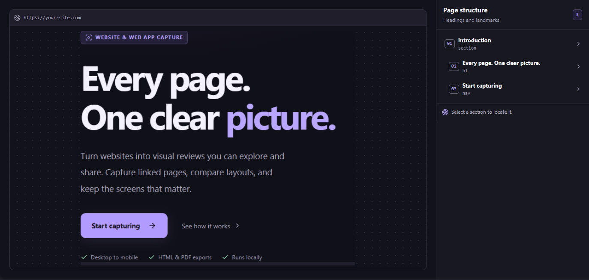

<p align="center">
  
</p>

<h1 align="center">PageAtlas</h1>

<p align="center">Capture a website or web app and turn it into a visual design review.</p>

<p align="center">
  
</p>

PageAtlas captures a website or browser-based app and turns it into a design review. Mobile reviews contain individual viewport screenshots taken while scrolling each page. Desktop and tablet reviews use full-page screenshots. Export the review as one HTML file that opens offline in a browser, or as a PDF of the screenshots.

## Set it up on your computer

Running PageAtlas on your own computer gives you every feature, including captures of local dev servers and pages that need a sign-in. Your captures never leave your computer.

### 1. Install what PageAtlas needs

- **Node.js 22.18 or newer.** Download the LTS version from [nodejs.org](https://nodejs.org). To check your version, open a terminal and run `node --version`.
- **Microsoft Edge or Google Chrome.** PageAtlas uses the browser already installed on your computer to take screenshots. Edge comes with Windows.
- **Git** (optional) to download and update the code. You can download a ZIP instead.

### 2. Download PageAtlas

With Git:

```sh
git clone https://github.com/Pongki69/PageAtlas.git
cd PageAtlas
```

Without Git, choose **Code → Download ZIP** on the [repository page](https://github.com/Pongki69/PageAtlas), then extract the ZIP to a folder such as your Desktop.

### 3. Start PageAtlas

**On Windows**, double-click **Start PageAtlas.bat** in the PageAtlas folder. The first start installs dependencies and builds the app, which takes a minute or two. Your browser opens PageAtlas when it's ready.

The launcher's menu offers **1. Start / open**, **2. Restart server with the latest changes**, **3. Stop server**, and **4. Close this menu**. Closing the menu leaves PageAtlas running in the background; open the batch file again to stop or restart it. Only one launcher menu stays open per project and port, and double-clicking again opens the existing app. Stop and restart clear in-memory captures and reviews, so export anything you want to keep first.

**From a terminal** (Windows, macOS, or Linux), run these commands in the PageAtlas folder:

```sh
npm ci
npm run build
npm start
```

In Windows PowerShell, type `npm.cmd` instead of `npm` if PowerShell blocks scripts. Keep the terminal open while you use PageAtlas.

### 4. Open the app

Go to [http://127.0.0.1:4317](http://127.0.0.1:4317). Choose **Start capturing**, paste a web address, and select **Capture app pages**. Bookmark `http://127.0.0.1:4317/#capture` to open the workspace directly.

### Update to the latest version

Run `git pull` in the PageAtlas folder (or download a new ZIP), then choose **2. Restart server with the latest changes** in the launcher, or run `npm ci`, `npm run build`, and `npm start` again.

### If something goes wrong

| Problem | What to do |
| --- | --- |
| `node` isn't recognized, or the launcher says Node.js is missing | Install Node.js 22.18 or newer, then open a new terminal or run the launcher again. |
| "Install Microsoft Edge or Google Chrome" | Install one of them, or set `PAGEATLAS_BROWSER` to the full path of another Chromium-based browser before starting. |
| "Port 4317 is already in use" | PageAtlas is probably already running, so open [http://127.0.0.1:4317](http://127.0.0.1:4317). To use another port, set the `PAGEATLAS_PORT` environment variable to a free port, such as `4400`, then start again. |
| "Build PageAtlas with npm run build, then refresh" | Run `npm run build`, then reload the page. |

### Develop PageAtlas

`npm run dev` starts the app with live updates to the interface and automatic server restarts. `npm run check` type-checks the project, and `node --test server/*.test.ts server/*.test.mjs` runs the tests.

## Capture and export

The front page introduces PageAtlas, explains the capture and export workflow, and describes temporary storage. Choose **Start capturing** or **Capture** in the header to open the workspace. Use **Home** or the PageAtlas logo to return to the front page; a running capture continues in the background. Bookmark `http://127.0.0.1:4317/#capture` to open the workspace directly.

1. Paste a public HTTP or HTTPS URL, or use the URL printed by a dev server running on this computer. PageAtlas accepts `localhost` and IP addresses assigned to this computer. For an HTTPS dev server you recognize, select **Allow local development certificate** or choose **Allow local certificate and retry** if a certificate error appears.
2. **Current screen** starts selected and matches the visible page area of your PageAtlas browser window when capture begins. Resize that window to match your target browser. You can also choose Desktop (1920 × 1080, Full HD), Tablet (768 × 1024), Mobile (390 × 844), or enter a **Custom** width and height. Dimensions use browser layout pixels, so display scaling and browser zoom are reflected in the responsive layout rather than multiplying the image resolution. The chosen size remains fixed throughout that capture, including sign-in and linked pages. **Capture linked pages** starts enabled for exploring the app. Turn it off for a single-page capture.
3. Use **Captured page** to switch screens. In Mobile mode, choose **Scroll view** to inspect each viewport and its structure map. Desktop and tablet captures include separate independently scrolling areas.
4. Export the review to one `.html` file that works offline. After the export response is sent, PageAtlas deletes the temporary review, its screenshots, and associated capture history. The app clears the preview and source URL. Choose **Done · delete review** to remove a review without exporting. The downloaded HTML stays on your device. Multi-page exports open with a summary (pages, screenshots, mapped elements, capture notes) and an index listing each page with its path. Each page is labelled **Page N of M**, has **Previous / All pages / Next** links, jump links to its screenshots, structure map, scrollable areas and notes, and starts on a new sheet when printed.

**Export all pages as PDF** downloads only the captured screenshots, in order. Each screenshot fits on its own landscape or portrait sheet without cropping; mobile scroll views are included in sequence. The PDF excludes review controls, structure maps, source URLs, and notes. PDF export also deletes the temporary review and capture history after the response is sent. Choose either HTML or PDF before exporting, since the review is cleared afterward.

Captures run as background jobs on this computer. The progress panel shows the current stage, captured page and screenshot counts, and a live activity log. Progress is estimated because linked pages are discovered during exploration. Refreshing PageAtlas reconnects to the running job and restores its result when it finishes. Only one capture can run at a time, including across browser tabs. **Stop capture** cancels the job and closes its temporary browser before another capture can start.

Job status and reviews stay in server memory. Stopping or restarting the server ends the running job. Activity logs are bounded and do not include source URLs or page contents. Captures reuse a recent content-readiness check only while the visible content, layout, and scroll position remain unchanged; navigation and scrolling still wait for loaded content.

Linked-page mode uses browser HTML and accessibility semantics to discover navigation across frameworks. It follows links, button-styled links, explicit route attributes, and bounded scalar URL queries. It also clicks visible non-action buttons, tabs, and menu disclosures, including controls with plain labels and views that change without a new URL. While a native or ARIA modal is open, discovery and clicks stay inside the active dialog. Direct links take priority over control exploration, and shared dialogs are captured once even when opened over different routes. It preserves the page reached by a JavaScript click and replays preceding navigation steps when needed, checking the source view as well as its URL before clicking. Open modals use viewport captures. It captures up to 30 views within its time and image-size limits and attempts up to 48 navigation controls. The review shows discovered controls, actual click counts, and labeled reasons for skipped controls. Coverage depends on the controls the site exposes and the pages accessible to the current account.

During control exploration, PageAtlas blocks data-changing HTTP requests and intercepts new windows. Forms and controls that appear to save, delete, pay, or submit are excluded from exploration. Apps that need an unsupported interaction or a write request to reveal a screen can produce a skipped-control notice.

Mobile mode scrolls down the document, main app panel, and independently scrollable cards. It records up to 30 viewport screenshots per page, with overlapping scroll positions for continuity. Sticky headers, floating controls, and bottom navigation appear in their actual positions in each view. The export groups these independent images in order under each captured page.

Before each page and scroll view, PageAtlas waits for visible loading indicators to clear, images and fonts to finish, and content to settle. Persistent loading produces a retry notice or a skipped-page warning. A mobile sequence can stop with a warning after its completed views if the next view stays loading.

For desktop and tablet captures, detected pinned bottom navigation is preserved in **Original viewport**. The full-page screenshot shows the underlying page content with the bottom overlay removed.

The structure map uses visible HTML headings and landmarks and can infer layout blocks on pages that lack them. PageAtlas keeps only the current review in temporary memory. Exporting or choosing Done deletes it; a new completed capture replaces it. Unfinished reviews expire after 15 minutes, and a background cleanup removes expired screenshots and job metadata. Captured reviews are not written to a server archive. Save the exported file to keep a review.

PageAtlas examines up to six scroll areas from the main document, including horizontal and vertical overflow. Mobile mode includes those areas as labeled viewport steps. Desktop and tablet modes assemble separate panel images. The review flags capture limits and skipped areas. Long or continuously loading panels can exceed those limits.

Desktop and tablet panels share a 25-second capture allowance, up to 96 tiles, and a 12-megapixel limit per image. PageAtlas retries once when lazy content changes a panel's dimensions. A partial panel shows its captured size, full content size, and the specific reason capture stopped.

## Capture a page that requires sign-in

1. Enter the site's HTTPS address, choose a viewport, and select **Sign in, then capture**. Turn on **Capture linked pages** if you want a multi-page review.
2. Open the temporary browser window from PageAtlas. Check the address, then sign in directly on the site and complete any verification it requires.
3. Navigate to the page you want and leave that tab active. Return to PageAtlas and select **Capture signed-in page**.

The temporary browser closes after a capture, cancellation, or 10 minutes of waiting. PageAtlas uses that browser's session for the capture. The exported source shows the site's origin so the page path and URL parameters stay out of the review metadata. Screenshots, headings, and exported files can contain visible account information.

## Host it online

The online version runs the capture server on [Render](https://render.com)'s free plan and serves the site from Vercel. Visitors stay anonymous. A cookie keeps each visitor's captures and reviews private to their browser, and reviews are deleted after 15 minutes. The online version captures public websites only: sign-in capture, local development certificates and addresses on private networks are turned off.

1. On Render, choose **New → Blueprint** and select this repository. Render reads [render.yaml](render.yaml) and builds the [Dockerfile](Dockerfile).
2. When Render asks for `PAGEATLAS_ALLOWED_ORIGINS`, enter your Vercel address, such as `https://pageatlas.vercel.app`.
3. Check that the service address in [vercel.json](vercel.json) matches your Render service (`https://pageatlas.onrender.com` by default), then redeploy on Vercel.

Render's free plan has about 512 MB of memory and sleeps after 15 minutes without traffic, so the first visit after a quiet period takes about a minute to wake up. The blueprint runs one capture at a time (later captures wait in line), allows 10 captures per visitor per hour, and explores up to 8 linked views. Change these with the `PAGEATLAS_*` settings in `render.yaml`. To also limit captures per network address, set `PAGEATLAS_PROXY_HOPS` to the number of proxies that add to `X-Forwarded-For`. Check the header first: with the wrong count, all visitors share one limit.
